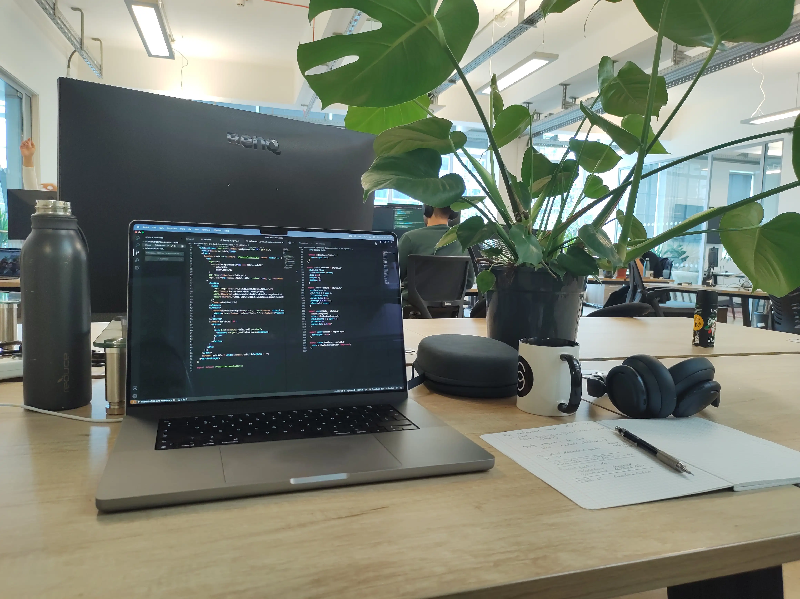

When I got my first developer job I jumped up and down for probably a solid minute. It had been a while since I had decided to make a switch. I kept my teaching job while I was learning on my own. I also kept if while I was doing one of the government-funded boot-camps that was around (don't know if they're still doing that). It had been such, well, maybe battle? Maybe just arduous journey? Not the learning, the application process and countless rejections and ghosting.

I had a few interviews that were all over the place, sometimes from my end, sometimes from the company's end. It probably wasn't as hard as if I was going to do the same today. But it still was drawn-out. I was, in the back of my mind, prepared to continue on with my teaching job and be back at the start of the school year. 

But after that call there was a sense of relief. Relief that I could send the email saying I wouldn't be back. Relief that I could cut down on my private tuition as well. Relief that I had a foot in the door. 

The job itself threw me right in the middle of things. Yes, my title was 'junior' but I was expected to perform. I mean, maybe that was in my head, but who knows. I wanted to prove myself anyway. I got to figure out a lot of stuff on my own. Going from setting up my own projects to trying to get the company’s services to run was an education in itself. It's one thing when it's just a local thing, but when there are auth services involved, databases, etc., it becomes something completely different. 

I was there for a short time but in that time I took away some good lessons. Coming from a position (teaching) where I was expected to be the knowledgeable one to a situation where I was brand new, it was hard to feel like I had it in me to ask questions. What if I asked the wrong question? What if it was a dumb question? Would they find out that I didn't actually know anything? 

There was a lot I had to work through on a personal level. Letting go of being... what is that, prideful? Is that a thing? In the end I think it's not that we're paid for our ability to remember stuff but to persevere and be the ones who investigate and find the answers. I've really tried to make a conscious effort to silence that little voice in my head which pops up from time to time when I'm about to ask a question. I just have to remember that if it popped into my head, it might also be on someone else’s mind. Even if it isn't, it might trigger a different question from someone. And that's how we collaborate and get things done.

It was exciting to be part of a team. It was exciting to be entering a new world. A world where the hours were 9 - 5. Where there was an office. Where we were building something people wanted to pay for. Where I got to talk about and have an impact on how a user interacted with our product. Moving from just using sites and apps to being on the other side felt, for lack of a better word, really cool.
