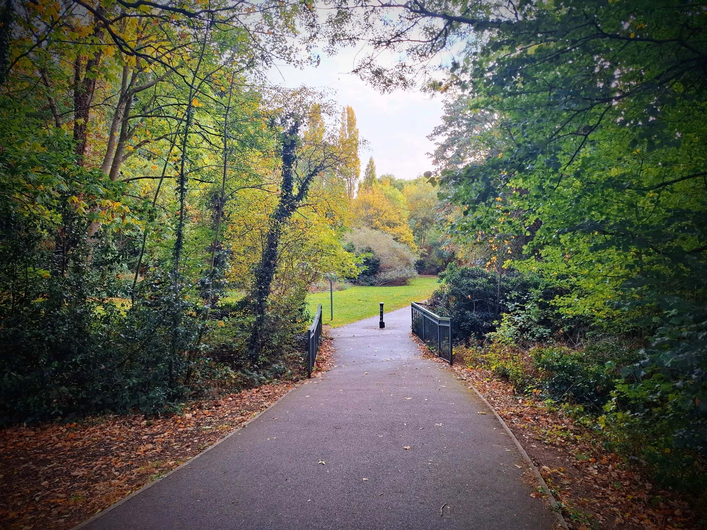

This is the kind of autumn I remember growing up in Michigan. Leaves on the ground. Ground damp. The smell of rain still in the air. I remember my old neighbourhoods in this kind of weather. I remember being in my teens and going driving on a day like this. My trusty VW Golf and whatever CDs I had burned that week. I remember listening to Smashing Pumpkins (Siamese Dream) and driving with no destination in mind. Driving on country roads that led to even smaller towns. Seeing towns that I only had seen as small dots on a map. 

I remember having the window cracked, Cherub Rock blaring from the speakers I had put in the trunk. I remember feeling the speed, the curves of the road, the tyres going over leaves, leaves being thrown into the air behind my car. I'd drive for hours. Sometimes I'd end up at the lake (Michigan). Those were the best. You'd drive feeling you were infinite and then get to the lake and feel how vast the world really was.
